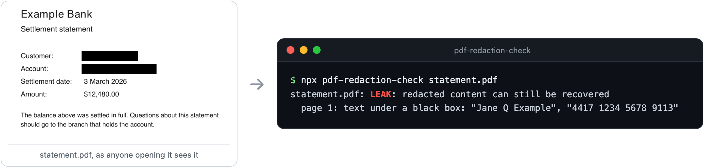

# pdf-redaction-check

Find redactions that didn't work.



A black rectangle drawn over text hides it on screen, but the text is still in the file: anyone can select it, copy it, or run `pdftotext`. Court filings, FOIA releases and HR documents leak this way every year. `pdf-redaction-check` opens a PDF the way an attacker would and tells you what can still be recovered.

```console
$ npx pdf-redaction-check docs/statement.pdf
docs/statement.pdf: LEAK: redacted content can still be recovered
  page 1: text under a black box: "Jane Q Example", "4417 1234 5678 9113"
```

[`docs/statement.pdf`](docs/statement.pdf) is the sample above, with made-up details, if you want to try it.

## What it checks

| Check | How | Verdict |
|---|---|---|
| **Text under black boxes** | Renders each page, finds solid dark rectangles, and reports text-layer words that sit entirely on dark pixels. White text printed on a dark bar is visible and is not reported. | leak |
| **Unapplied Redact annotations** | A `/Redact` annotation marks an area to be removed, but nothing is removed until the redaction is applied. Until then the text underneath is intact. | leak |
| **Earlier saved versions** | Many editors save by appending an *incremental update*, so the original bytes stay in the file. Each earlier version is opened and any text the current version no longer has is reported. | leak |
| **Terms you name** (`--term`) | Searches the text layer and earlier versions for each term. | leak |
| | Also searches the raw file bytes, for text that is not in the visible text layer. | warn |
| **Metadata** | `Author` and `Keywords` in the document info, and any XMP packet. | warn |

It never modifies the file and never sends it anywhere.

## Command line

```console
$ npx pdf-redaction-check [options] <file.pdf>...

  -t, --term <text>      Also fail if this text can be found (repeatable)
      --fail-on <level>  Exit 1 at "leak" (default) or at "warn"
      --json             Print the full reports as JSON
  -q, --quiet            Print nothing; use the exit code
```

Exit codes: `0` passed, `1` a file reached the `--fail-on` level, `2` error. That makes it usable as a release gate:

```yaml
- run: npx pdf-redaction-check --term "Jane Q Example" --fail-on warn out/*.pdf
```

## Library

```js
import { readFile } from "node:fs/promises";
import { checkRedaction } from "pdf-redaction-check";

const report = await checkRedaction(new Uint8Array(await readFile("statement.pdf")), {
  terms: ["Jane Q Example"],
});

report.verdict; // "leak" | "warn" | "clean"
report.pages[0].textUnderRects; // ["Account 4417 1234 5678 9113"]
report.earlierVersions.removedText; // text present in an earlier save but not the final one
report.pendingRedactAnnotations; // Redact annotations that were never applied
```

`formatReport(report, fileName)` returns the same text the CLI prints. The pixel-level helpers (`darkMask`, `findDarkRects`, `hiddenText`) and the revision helpers (`earlierRevisionEnds`, `removedText`) are exported too.

Requires Node.js 22.13 or later. Rendering uses [pdf.js](https://github.com/mozilla/pdf.js) with [`@napi-rs/canvas`](https://github.com/Brooooooklyn/canvas), so there is nothing to install beyond npm.

## Limits

A clean result means none of these checks found anything, not that the file is safe.

- **Scanned pages** have no text layer, so there is nothing to find under a box. The report says so.
- **Boxes in other colours** (white, grey, a highlighter) are not treated as redactions.
- **Text drawn as vector outlines or images** is not text to pdf.js, so it is not reported.
- **Earlier versions**: up to 25 are opened; a file with more keeps its first and its latest 24.

## Origin

The checks come from the redaction checker in [PDFAirlock](https://pdfairlock.com), a set of PDF tools that runs entirely in the browser, extracted into a library and CLI that run in Node and CI.

## License

MIT
